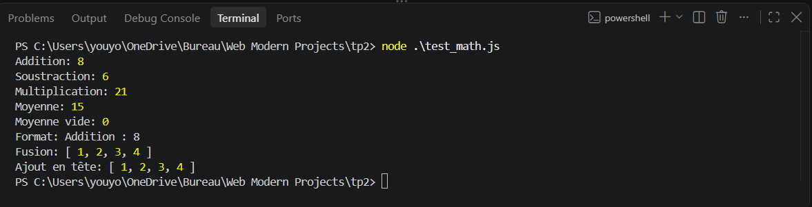
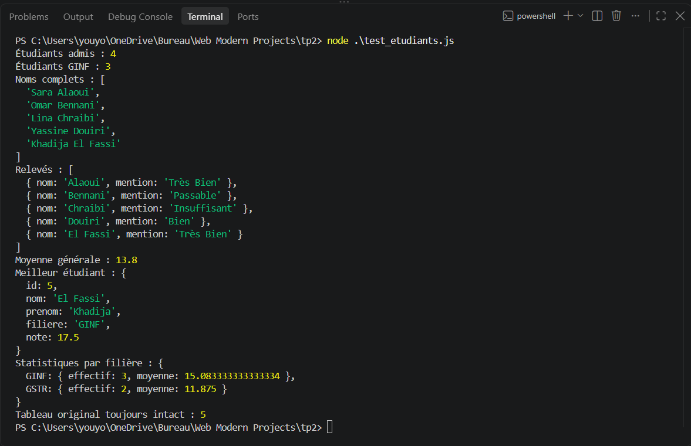
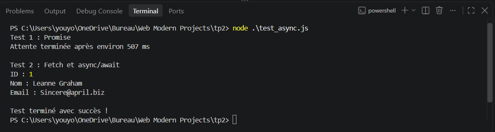
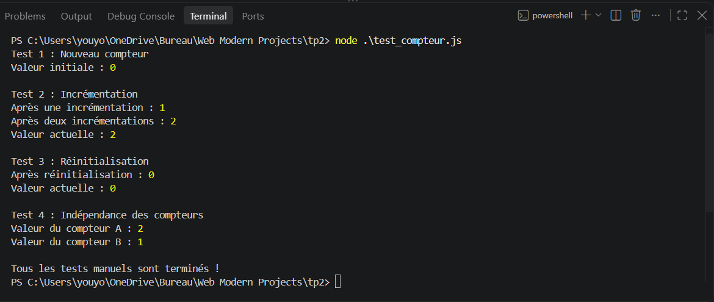

# TP évalué — Mini-modules Node.js ES6+

## Objectif

Ce TP consiste à réaliser quatre mini-modules Node.js en utilisant les fonctionnalités modernes de JavaScript (ES6+), puis à vérifier leur exécution à l'aide de fichiers de test.

## Prérequis

- Node.js 18 ou une version plus récente.
- npm, installé avec Node.js.
- Une connexion Internet pour tester `fetch()` dans `mod_async.js`.

Le projet utilise les modules ES avec `"type": "module"` dans `package.json`.

## Structure du projet

```text
tp2/
├── package.json
├── mod_math.js
├── test_math.js
├── mod_etudiants.js
├── test_etudiants.js
├── mod_async.js
├── test_async.js
├── mod_compteur.js
├── test_compteur.js
├── README.md
└── captures/
    ├── test_math.png
    ├── test_etudiants.png
    ├── test_async.png
    └── test_compteur.png
```

## Module 1 — `mod_math.js`

Ce module présente :

- les fonctions fléchées : `addition`, `soustraction` et `multiplication` ;
- le paramètre rest (`...nombres`) avec `moyenne` ;
- les template strings avec `formatResultat` ;
- le spread (`...`) avec `fusionnerTableaux` et `ajouterEnTete`.

### Exécution

```bash
node test_math.js
```

## Module 2 — `mod_etudiants.js`

Ce module manipule un tableau d'objets étudiants et présente :

- la déstructuration d'objets ;
- `filter()` pour sélectionner les étudiants admis et filtrer par filière ;
- `map()` pour les noms complets et les relevés avec mention ;
- `reduce()` pour calculer la moyenne générale et regrouper les statistiques par filière ;
- le spread et la déstructuration pour trouver le meilleur étudiant sans trier le tableau original.

### Exécution

```bash
node test_etudiants.js
```

## Module 3 — `mod_async.js`

Ce module présente :

- `Promise` et `setTimeout()` avec `attendre()` ;
- `async/await` ;
- `fetch()` pour demander les données d'un utilisateur à l'API de test JSONPlaceholder ;
- la vérification de la réponse HTTP et la gestion des erreurs.

### Exécution

```bash
node test_async.js
```

Une connexion Internet est nécessaire pour la partie `fetch()`.

## Module 4 — `mod_compteur.js`

Ce module présente une closure qui conserve un état privé. La fonction `creerCompteur()` retourne les méthodes suivantes :

- `incrementer()` : augmente le compteur de 1 ;
- `obtenirValeur()` : lit la valeur courante ;
- `reinitialiser()` : remet le compteur à zéro.

Chaque compteur créé possède son propre état.

### Exécution

```bash
node test_compteur.js
```

## Captures d'écran des exécutions









## Dépôt Git

Le dépôt doit contenir les fichiers du projet, ce README et les captures d'exécution. Le tag demandé pour la remise est `tp2`.